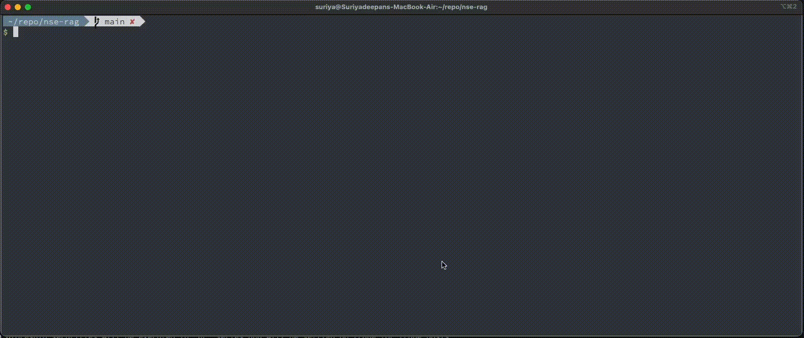
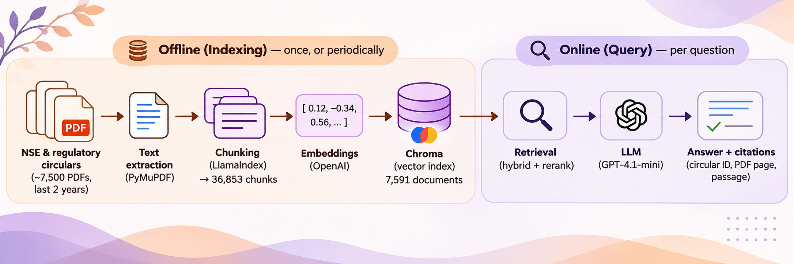
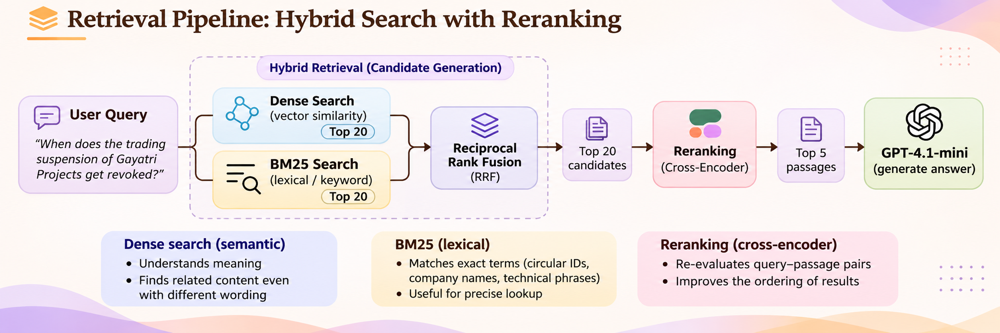

# NSE Circular RAG



A local proof of concept for searching a downloaded exchange circular PDF/metadata collection with dense or hybrid retrieval and generating answers with inspectable PDF citations. The collection is not guaranteed to contain only NSE circulars.

## Architecture



PyMuPDF extracts PDF text page by page, and LlamaIndex's `SentenceSplitter` creates page-aware chunks. OpenAI `text-embedding-3-small` creates embeddings stored in a local Chroma index; matching chunk text is retained locally so the query CLI can also build the BM25 retriever. Hybrid mode combines dense and BM25 rankings with Reciprocal Rank Fusion (RRF). `hybrid-rerank` sends the fused candidates to Cohere Rerank v5 Fast. GPT-4.1-mini answers from retrieved passages and checks answer claims against their cited passages. Chroma and BM25 data stay under `data/index/`; there is no OCR or hosted vector database.

Indexed metadata can include `circular_id`, `title`, `date`, `category`, `source`, and `pdf_path`. IDs and titles are also included in searchable text; citations use the actual PDF page number extracted by PyMuPDF. Metadata is descriptive and does not prove PDF identity. Its `page` field is an archive listing page and is not used as a PDF citation. Missing or unusable PDFs may be skipped.

## Requirements

- Python 3.14 and [`uv`](https://docs.astral.sh/uv/)
- Existing files under `data/pdfs/*.pdf` and `data/metadata/*.json`
- An OpenAI API key for embedding and answer generation
- A Cohere trial/API key only when using `hybrid-rerank`

Corpus PDFs and metadata are local inputs and are not downloaded by these commands. Chroma vectors and BM25 node data are stored locally under `data/index/`. PDF text is sent to OpenAI for embeddings; retrieved candidate passages are sent to Cohere only in `hybrid-rerank` mode. Keep Cohere queries sequential and within your account's rate limits.

## Setup

```bash
uv sync
cp -n .env.example .env
```

Edit `.env` and set `OPENAI_API_KEY`. Set `COHERE_API_KEY` to enable reranking. Keep `.env` private; it is ignored by Git. Commands below load it through `uv`.

If your corpus is not already present, use the existing downloader separately. It obtains listing/detail information from `exchangecirculars.com` and may extract PDFs from ZIP responses. RAG ingestion itself uses only local files.

## Build the full local index

```bash
uv run --env-file .env nse-rag ingest
```

This processes all sorted `data/pdfs/*.pdf` files, matches per-document JSON metadata under `data/metadata/`, and builds a fresh local Chroma collection plus its matching BM25 corpus. The command reports PDFs found, metadata records loaded, documents indexed/skipped and chunks indexed. Re-running `ingest` replaces the POC collection and `data/index/nodes.jsonl`; incremental or resumable ingestion is not implemented.

Optional input/output paths and embedding batch size:

```bash
uv run --env-file .env nse-rag ingest \
  --pdf-dir data/pdfs \
  --metadata-dir data/metadata \
  --index-dir data/index \
  --batch-size 128
```

## Ask questions

```bash
uv run --env-file .env nse-rag query "What changed in circular NSE/CMTR/123?" --mode dense
uv run --env-file .env nse-rag query "Which trading requirements changed?" --mode hybrid
uv run --env-file .env nse-rag query "Which trading requirements changed?" --mode hybrid-rerank
```



Modes are `dense`, `hybrid` (local BM25 + dense retrieval with reciprocal rank fusion), and `hybrid-rerank` (hybrid followed by one Cohere rerank request). All use the same defaults: 20 candidates and 5 final passages. Adjust them with `--candidate-top-k` and `--top-k`; the candidate limit must be at least the result limit. No metadata filters are available: applying them consistently to both dense and BM25 retrieval before fusion would require additional custom behavior.

Answers use GPT-4.1-mini and display cited circular IDs, actual 1-based PDF page numbers, and supporting passages. The CLI also checks answer claims against their cited sources and labels each **Supported**, **Unsupported**, or **Needs review**. If a check fails or source mapping is incomplete, it defaults to **Needs review**; claim splitting and source mapping can be approximate, so labels are an aid rather than a guarantee. The linked source passages remain visible for inspection. If retrieved evidence is insufficient or cannot be cited, the CLI says so rather than guessing. The listing metadata `page` field is never used as a PDF page citation.

## Evaluation and benchmark

Run the saved 24-query retrieval comparison or the smaller latency/cost benchmark against the existing local index:

```bash
uv run --env-file .env python scripts/evaluate_rag.py
uv run --env-file .env python scripts/benchmark_performance.py
```

The evaluator runs 24 source-verified queries through all three modes with 20 candidates and top 5; Cohere requests are sequential and paced. The performance script uses 10 representative queries, one warm-up and three measured repetitions per mode. It also samples five GPT-4.1-mini answers for token usage and cost. Both scripts reuse `data/index`; neither ingests or rebuilds it.

The full F001 ingestion run found 7,614 PDFs and 7,612 per-document metadata JSON files; ingestion loaded 7,611 metadata records, indexed 7,591 documents and skipped 23, producing 36,853 chunks in about 11 minutes 47 seconds. Textless/unusable PDFs account for skips observed in that run. The metadata-file discovery count and ingestion-loaded count describe separate checks.

## Retrieval evaluation

We compared dense, hybrid (BM25 + dense with reciprocal rank fusion), and hybrid with Cohere reranking on the persisted full index: 7,591 PDFs and 36,853 chunks. F002 used the same 24 source-verified queries and retrieval limits (20 candidates, top 5) for each mode. Scores are document-level; duplicate chunks from one circular count once. F003 measured latency separately using 10 representative queries (2 exact-ID, 4 keyword/phrase, 4 semantic), with one warm-up and three measured repetitions per query/mode.

| Metric | Dense | Hybrid | Hybrid + Rerank |
|---|---:|---:|---:|
| Recall@5 | 0.4375 | 0.7083 | 0.7292 |
| MRR | 0.4063 | 0.5708 | 0.7153 |
| Supported answers (sample) | 3/3 | 3/3 | 3/3 |
| Retrieval latency — average (F003) | 0.769 s | 0.698 s | 1.464 s |
| Retrieval latency — p50 (F003) | 0.516 s | 0.521 s | 1.275 s |
| Approx. query cost | ~$0.0000004* | ~$0.0000004* | ~$0.0000004*; Cohere unavailable |

Nine GPT-4.1-mini answers (three per mode) were manually checked against cited passages; all nine were supported. The separate F003 answer sample used hybrid retrieval: five answers averaged 1.863 s and cost $0.0032728 total (about $0.000655 per sampled answer, or $0.000656 including one estimated query embedding). The `~$0.0000004` table estimates are query-embedding cost only, not account usage; Cohere usage was unavailable. F001's one-time full-corpus embedding cost remains an approximately $0.24 estimate and was not incurred again. OpenAI prices were checked on 2026-11-26.

Reranking improved the overall scores, though semantic-query Recall@5 fell to 0.5000, below dense and hybrid (both 0.6667). The 24-query set contains six source-verified queries of each type: exact ID, keyword/phrase, semantic and multi-circular. Expected IDs were checked against indexed PDFs and relevant page text.

The F003 sample of five GPT-4.1-mini answers used 7,270 input and 228 output tokens, with an estimated $0.0032728 total answer cost ($0.000655 per sampled answer). Query embedding is estimated at about $0.0000004 per query. Cohere usage and rerank cost were unavailable, so rerank cost is not included. The one-time F001 corpus embedding estimate was about $0.24 and was not incurred again for these evaluations.

See the [F002 evaluation report](eval/report.md) for query-type breakdowns and answer evidence; [ranked results](eval/results.json) contain per-query IDs and metrics. See the [F003 performance report](eval/performance-report.md), [raw measurements](eval/performance-results.json), and [failure analysis](eval/failure-analysis.md) for benchmark details, costs and limitations. F004's [claim validation review](eval/claim-validation.md) and [citation integrity spot-check](eval/citation-check.md) record how claim labels and citations were manually examined. Automated claim checks are approximate aids, not guarantees; inspect the linked evidence.

## Development checks

```bash
uv run pytest
```

The test suite uses mock embeddings, answer models and rerankers; it does not make paid API calls. Full-corpus embedding and live API validation are separate checks.
